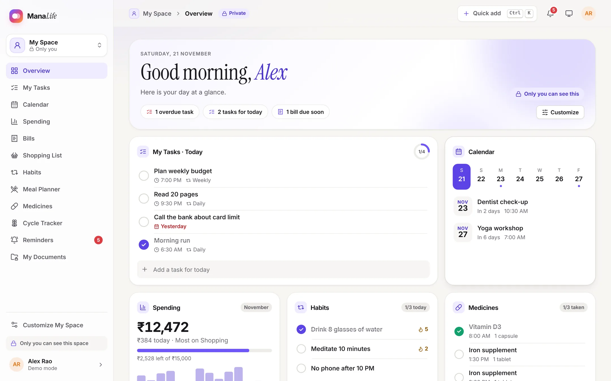
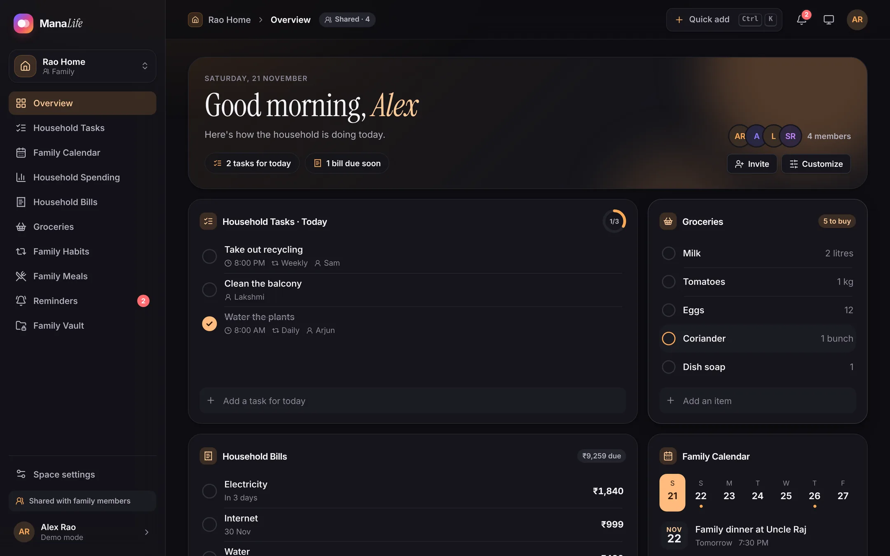
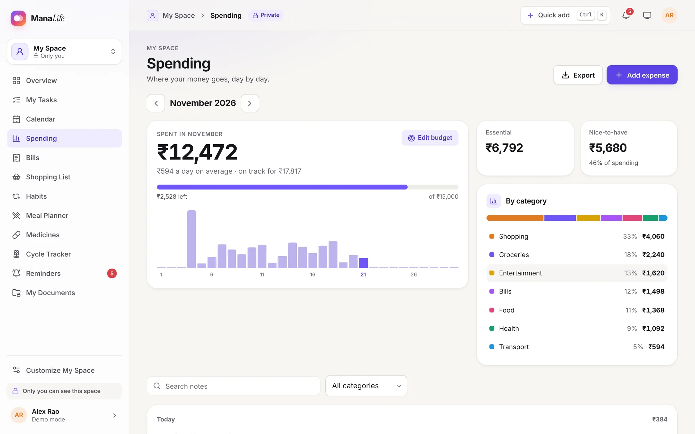
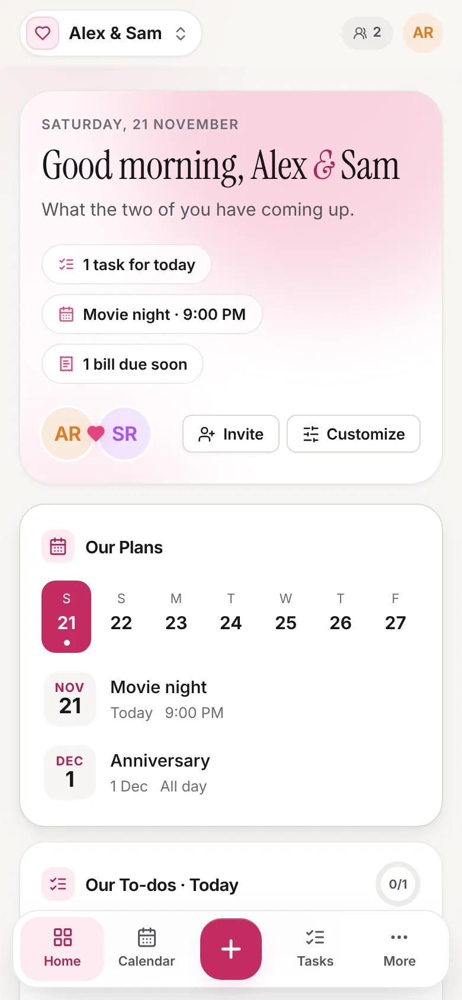
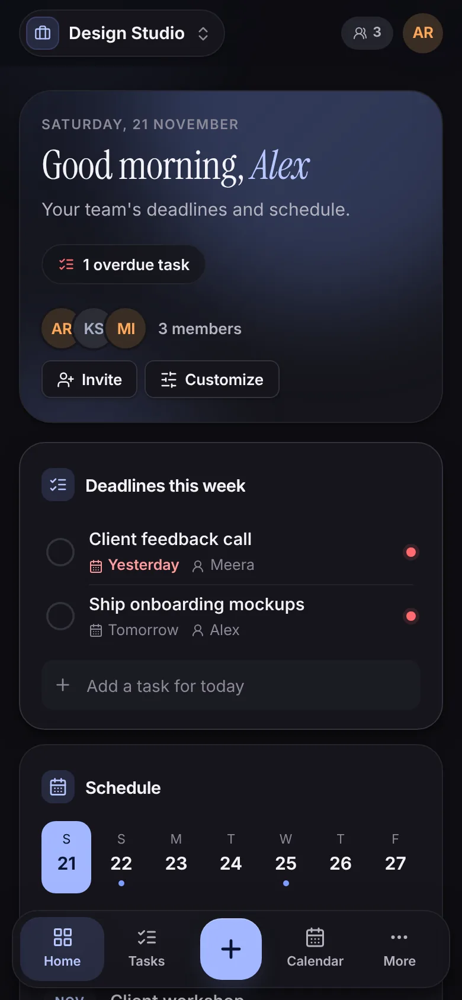

# ManaLife 2.0

**Your life. Your people. Your space.**

ManaLife is a personal and shared life-management app built with React, Vite and Supabase, and
shipped as a website, an installable PWA, and Android/iOS apps through Capacitor.

- **My Space**: private to you. Tasks, spending, bills, calendar, habits, meals, shopping,
  medicines, cycle tracking, reminders and documents.
- **Shared spaces**: Couple, Family, Friends, Office or Custom. Each has its own vocabulary,
  colour, dashboard and feature set. You invite people with a link or code, and they only get in
  after you admit them.

| My Space | Family space (dark) | Spending |
|---|---|---|
|  |  |  |

| Couple (phone) | Office (phone, dark) |
|---|---|
|  |  |

See **[docs/REDESIGN.md](docs/REDESIGN.md)** for the audit of V1, the product structure,
architecture and design decisions.

---

## 1. Try it locally (demo, no database needed)

Requires Node.js 22+.

```bash
npm install
npm run dev
```

Open the address Vite prints (usually http://localhost:5173) and choose **Explore the demo**.
The demo runs the real app against sample data stored only in that browser. It includes a
personal space and four shared spaces.

## 2. Connect your Supabase project

```bash
cp .env.example .env.local
```

Fill in `VITE_SUPABASE_URL` and `VITE_SUPABASE_PUBLISHABLE_KEY` (Project Settings → API).
Only ever use the **publishable/anon** key. Never put a `service_role` or secret key in any `VITE_`
variable, because those are visible in the browser. Restart `npm run dev`.

## 3. Upgrade an existing ManaLife database (do this once)

ManaLife 2.0 runs on your current database **as is**: existing rooms, members, tasks, groceries,
bills, events, expenses, habits, meals, medicines, cycle data and invitations keep working.
Two optional migrations switch on the new features.

| Step | File | What it does |
|---|---|---|
| 0. Back up | `supabase/introspect.sql` | Read-only. Exports your live tables, RLS policies and functions. **Save the output.** It is also the missing documentation of your current schema (see below). |
| 1. Spaces 2.0 | `supabase/migrations/001_spaces_v2.sql` | Adds **My Space** (one private space per person, guaranteed by the database), the **Couple** type, space icon and colour, owner-only **remove member**, and automatic revoking of cycle sharing when someone leaves. |
| 2. Documents | `supabase/migrations/002_documents.sql` | Adds the **Documents vault**: a private Storage bucket plus a metadata table, both readable only by members of the space. |

Run each file in **Supabase → SQL Editor**. Both are transactional (all or nothing), additive
(no existing rows are changed or deleted), safe to re-run, and leave every existing function
in place. Afterwards **Account → Account & privacy** in the app shows "ManaLife 2.0 ready".

What you'll see **before** running the migrations: everything works as in V1 with shared spaces.
My Space, Couple spaces, custom colours, member removal and Documents show a short
"needs a database update" notice instead of failing.

> **About `schema.sql`:** it only describes the original 2-person household. Tables and
> functions added later (expenses, habits, meal plans, medicines, cycle tracking, rooms, join
> approval) exist only in your live database. Commit the output of `introspect.sql` (for example
> as `supabase/live-schema.sql`) so a brand-new project can be recreated. Until then, a new
> Supabase project created from `schema.sql` alone will not support those features.

> **Cycle sharing in Couple spaces:** sharing still uses your existing `period_shares` table and
> its policies. If those policies only allow `room_type = 'family'`, sharing inside a *couple*
> space will show a permission error (no data is exposed). Check the `period_shares` policies in
> the introspect output; to include couples, extend that condition to `('family','couple')`.

### Testing the migrations yourself (optional)

`supabase/tests/run-local.sh` runs the migrations against a **throwaway local PostgreSQL**, never
your Supabase project. It covers both possible column types and checks privacy rules as real
users under RLS:

```bash
PGHOST=localhost PGPORT=5432 PGUSER=postgres bash supabase/tests/run-local.sh
```

## 4. Scripts

| Command | Purpose |
|---|---|
| `npm run dev` | Development server |
| `npm run build` | Production web build with PWA (`dist/`) |
| `npm run preview` | Serve the production build locally |
| `npm run lint` | ESLint (incl. React Hooks rules) |
| `npm test` | Unit tests (dates, recurrence parity with V1, bills, habits, cycle, demo client…) |
| `npm run build:mobile` | Web build for Capacitor (no service worker) |

## 5. Deploy

**GitHub Pages (current setup).** `.github/workflows/deploy.yml` builds on every push to `main`.
Keep the repository **Actions variables** `VITE_SUPABASE_URL` and `VITE_SUPABASE_PUBLISHABLE_KEY`.
Optionally add `VITE_PUBLIC_APP_URL` (e.g. `https://app.pramodbenno.in`) and pass it in the
workflow's build step. That is the address used in invite links.

**Vercel / Netlify.** Framework: Vite. Build `npm run build`, output `dist`. Add the same variables.
The app uses hash routing (`/#/space/...`), so no rewrite rules are needed.

**Supabase Auth URLs.** In Authentication → URL Configuration, set the Site URL to your live HTTPS
domain and add it to Redirect URLs. The new **Forgot password** flow sends people back there.

## 6. Android & iOS (Capacitor)

Unchanged from V1 (see `MOBILE_README.md`). `npm run build:mobile` (or `node scripts/build-mobile.mjs`)
followed by `npx cap sync`. The GitHub Actions workflows for the debug APK and the unsigned iOS
project keep working. Every screen now has its own URL, so Capacitor's default WebView back
handling should move between screens on Android. This wasn't tested on a device (see Known limitations).

## 7. Project structure

```
src/
├── app/          App providers, auth gate, router, shell (sidebar/topbar/bottom nav), space context
├── config/       Space types (vocabulary, defaults), modules registry, accents, icons
├── lib/          Supabase client, demo client, dates, recurrence, formatting, errors, storage
├── services/     All database access (spaces, tasks, lists, money, routines, health, documents, profile)
├── hooks/        Auth, workspace, theme, data (TanStack Query), today, media queries
├── motion/       Motion (LazyMotion) setup and presets; respects reduced motion
├── ui/           Design-system components: Button, Field, Sheet, Toast, Confirm, Menu, Card, charts…
├── features/     auth · onboarding · dashboard (widgets) · spaces · tasks · groceries · bills
│                 · expenses · calendar · habits · meals · medicines · cycle · reminders
│                 · documents · settings · quickadd
├── styles/       tokens.css (light/dark), base, ui, shell, features
└── __tests__/    Vitest unit tests
supabase/
├── schema.sql            Original V1 schema (unchanged)
├── introspect.sql        Read-only export of the live schema
├── migrations/           001_spaces_v2.sql, 002_documents.sql
└── tests/                Local migration test-suite
```

## 8. Privacy model

- Every space is a row in `households`, and every shared table is protected by membership-checked
  Row Level Security. A personal space is simply a space that the database guarantees can
  never have a second member.
- Medicines and cycle entries belong to the **user**, not to a space. Cycle data is visible to
  someone else only after an explicit, revocable, read-only grant inside a couple/family space.
- Signing out clears all cached data in the app. The service worker never caches Supabase responses.
- Demo data lives only in the browser's local storage and is never sent anywhere.

## 9. Known limitations

- Reminders are in-app (agenda and badge). Push notifications need a server plus the Capacitor
  push plugin, and are not included.
- Splitting group expenses between friends (who owes whom) would need a new table; it isn't built yet.
- Not verified in this update: the real Supabase project (only the demo, a local PostgreSQL copy of
  the schema, and a simulated V2 drift were tested), and the Android/iOS apps on a device.
- Sync is "near-live": shared spaces refresh every 30 seconds and whenever the app regains focus.
  Supabase Realtime could make it instant (it needs a publication change).
